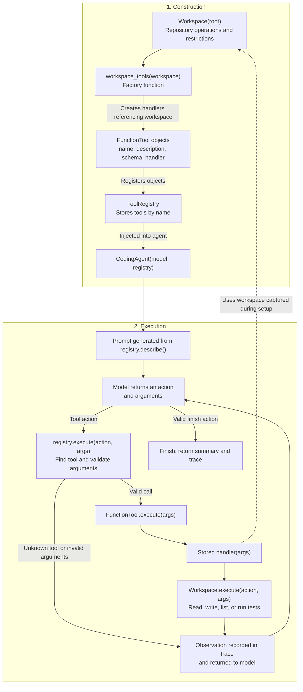
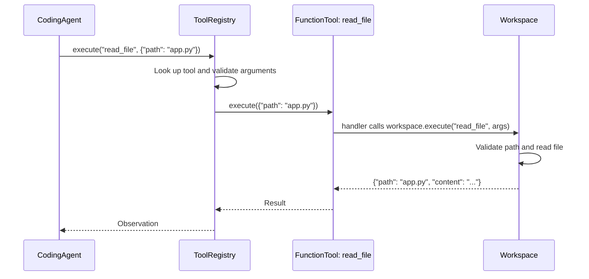
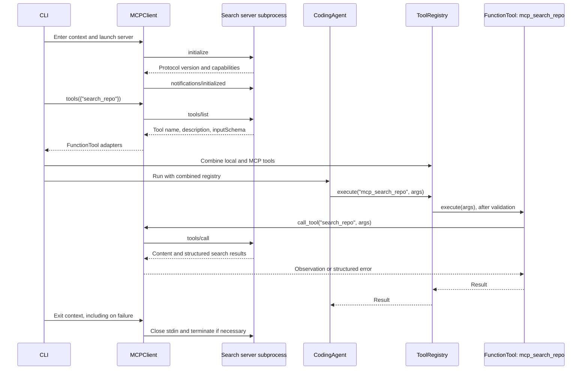

# Tool Integration Architecture

Tool integration has two stages: `workspace_tools()` constructs and connects the tools, then `CodingAgent` invokes them through the registry during execution.

## Construction and Execution

`workspace_tools()` runs during construction, not during each tool call. It creates `FunctionTool` objects whose handlers retain a reference to the supplied workspace. The registry stores those objects by name and generates their descriptions for the model prompt.

## Example: Reading a File

The registry retrieves an actual `FunctionTool` object, so `tool.execute()` invokes `FunctionTool.execute()` through normal Python method lookup. That method calls its stored handler, which delegates to the workspace.

## Responsibilities and Boundaries

`Tool` is a protocol describing the attributes and execution method a registered tool must provide; it is not another execution step. `FunctionTool` implements that contract by wrapping a callable. Other implementations can satisfy the protocol without inheriting from it or depending on a workspace.

`ToolRegistry` handles lookup, argument validation, and structured errors for unknown tools, invalid arguments, and expected execution failures. Its current schema support is limited to closed objects with string properties. `Workspace` owns repository operations and filesystem restrictions; path validation does not provide a security sandbox.

`CodingAgent` handles model interaction, action parsing, observations, tracing, and termination. The `finish` action belongs to the agent lifecycle rather than the registry. Runs also stop at the configured step limit; a finished run does not independently establish task correctness.

The current implementation retains a second dispatcher in `Workspace.execute()`. A later simplification could expose explicit workspace methods and connect handlers directly to them. MCP tools use the same registry through a subprocess client adapter; the current adapter accepts only the registry’s restricted string-object schemas.

## MCP Search Integration

The model still chooses the action. The registry dispatches to a function adapter,
whose handler sends an MCP request instead of calling `Workspace.execute()`.
The search server has its own repository root and read-only implementation;
local editing and pytest tools continue to use `Workspace`. The server process
persists across calls and is closed when the CLI run ends.

This is a small implementation of the
[MCP stdio transport](https://modelcontextprotocol.io/specification/2025-11-25/basic/transports)
and [tool discovery/calls](https://modelcontextprotocol.io/specification/2025-11-25/server/tools),
not a general-purpose SDK. Tools are explicitly selected and namespaced with
`mcp_`; unsupported schemas fail during setup. Transport failures invalidate the
connection, while tool execution errors are returned as observations. See the
README for limits and supported behavior.
