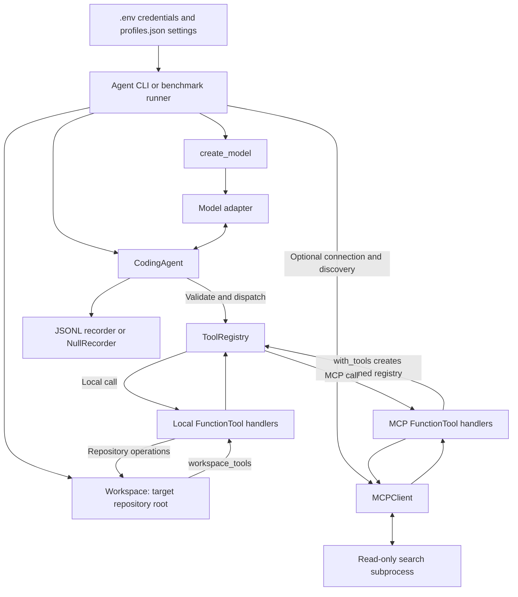
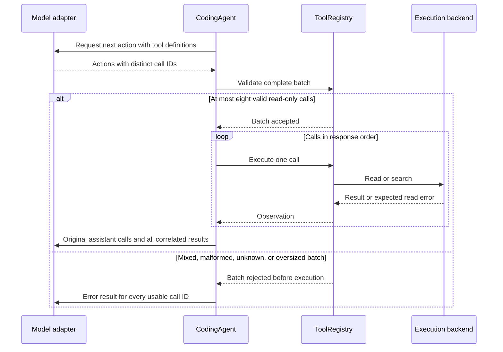

# Architecture

[Usage and commands](../README.md) · [Configuration](configuration.md) ·
[Tools](tools.md) · [Evaluation](evaluation.md) · [Logs](observability.md)

## System Overview

The application connects a configured model to registered tools over an explicit
execution loop. The model proposes actions; the application validates and
executes them. The entry point owns configuration and resource lifetimes, while
`CodingAgent` receives constructed objects rather than reading configuration files.



## Entry Points and Configuration

`mini-coding-agent` calls `coding_agent.cli.main`. It requires a task and an
existing `--workspace` directory, operates directly on that directory, and prints
a JSON result. `mini-coding-agent-evaluate` calls `benchmarks.evaluate.main`. It
selects bundled tasks, creates fresh workspaces, grades results, and writes a
report. These console scripts are declared in `pyproject.toml`.

Both entry points load optional `.env` values from the current working directory,
register CLI options, and apply an explicitly selected profile. The supplied
profiles are `local-qwen` and `deepseek`. With a profile, precedence is explicit
flags, profile values, then built-in defaults. Profiles replace legacy MODEL_*
defaults as a unit, preventing mixed-provider settings. Credentials are still read
from environment variables, with existing shell values taking precedence over
`.env`. No profile is selected automatically.

Profile and environment paths belong to invocation configuration, not the target
workspace. `load_profile()` returns validated nonsecret settings for reuse by
other entry points. Profile name and settings hash appear in reports and events;
the hash describes the profile before explicit CLI overrides.

## Workspace: Where Code Operations Happen

`Workspace(root)` represents the repository being inspected and changed. It is
not the agent implementation directory, model configuration, or tool registry.
A relative request such as `read_file("module.py")` resolves against this root.

For manual runs, the caller supplies the root. For benchmarks, a fixture is
copied into a temporary trial directory and that copy becomes the workspace.
Reports and logs are separate artifacts that can outlive the temporary copy.
The bundled MCP server receives the same trial root explicitly.

The current local backend resolves paths, rejects traversal outside the root,
reads files, modifies existing Python files, and starts pytest. It is not a
sandbox: subprocesses execute with the current user's permissions and inherited
environment. It does not create new files or provide a Docker backend. Planned
execution isolation and patch delivery are described in the [roadmap](roadmap.md).

## Tool Construction and Dispatch

`Tool` is a protocol. `FunctionTool` implements it by storing a name, description,
argument schema, handler callable, and `read_only` declaration. `workspace_tools`
wraps workspace operations in these objects, capturing the workspace in each
handler, and returns a `ToolRegistry`.

The registry stores actual tool objects by name, supplies copied specifications,
validates arguments, and calls the selected object's `execute()`. A local
wrapper calls `Workspace.execute()`; an MCP wrapper calls `MCPClient.call_tool()`.
There is no automatic implementation discovery during method dispatch.

```text
CodingAgent
  -> ToolRegistry.execute(name, arguments)
     -> registered FunctionTool.execute(arguments)
        -> stored handler(arguments)
           -> Workspace.execute(name, arguments), or MCPClient.call_tool(...)
```

`Workspace.execute()` retains a second local dispatcher; this is an explicit
current design, not a separate model-facing registry. Supported schemas are
closed objects with string-valued properties. Errors from expected tool failures
become observations; unexpected tool exceptions abort the run.

## Model and Action Boundary

`models.py` defines `Model`, `ModelResponse`, `OllamaModel`,
`OpenAICompatibleModel`, and `create_model()`. The original model imports remain
re-exported from `core.py`. The agent does not construct providers or assemble
provider-specific HTTP payloads.

Ollama text mode requests JSON action content through `/api/chat`. The loop
strictly parses one action object. The DeepSeek profile uses native function
calling through the compatible adapter's `/chat/completions` endpoint. The agent
passes registry specifications plus a lifecycle `finish` function to the adapter.
The adapter supplies them through the provider's `tools` field rather than
requiring action JSON in ordinary answer text.

`AgentAction` contains a function name, argument object, and optional call ID.
Native responses populate `ModelResponse.actions` for the entire response and
`action` for a single call. They also carry completion metadata and provider
assistant state needed to return observations correctly.

In native mode, each result uses `role: tool` with its original `tool_call_id`.
Provider reasoning content required for conversation continuity remains in memory
and is excluded from traces and event metadata. Ordinary answer text is not an
executable action in native mode. The agent ends only on a valid `finish` call
or another termination condition; `finish` is not a registered workspace tool.

Malformed argument JSON, ambiguous text actions, and token-limit completions do
not execute tools. Usable call IDs receive correlated rejection results. Missing
or duplicate native IDs make the response a model error rather than a tool call.
Native calling improves protocol structure, not semantic repair correctness.

## Sequential Read-Only Batches

Host declarations determine batch eligibility. Local `list_files` and `read_file`
are read-only; writes and `run_tests` are not. The CLI and evaluator explicitly
mark their bundled MCP search adapter read-only. Server annotations alone do not
establish trust. Custom tools default to non-read-only.



Whole-batch preflight checks tool registration, read-only declarations, and
argument schemas. Writes, tests, and `finish` must be individual calls. Runtime
path checks occur during execution: an expected read failure returns an error
for that call while remaining reads continue. An unexpected crash aborts the
run and preserves completed observations in its trace and events.

Calls execute sequentially, without threads. Only after all batch results are
available does another model request occur. `steps` counts completed model-response
turns, including rejected responses and `finish`; individual batch trace entries
share a step and have separate call IDs and batch indexes. Tool counts remain
individual counts. Trace length must not be used as the step budget.

## MCP Process Lifecycle

When MCP search is enabled, the entry point starts
`python -m coding_agent.mcp_search_server --workspace ROOT` through `MCPClient`.
Initialization precedes discovery with `tools/list`. Explicitly selected tools
become namespaced `FunctionTool` adapters, and `with_tools()` constructs a combined
registry before the agent starts. Execution does not call the factory again.

The stdio connection remains open across calls. `tools/call` responses become
observations, while transport failures invalidate the connection. Entry-point
resource management closes the process after agent success or failure. The
server never executes local editing tools and does not discover other servers.
This is a narrow synchronous stdio implementation, not a general-purpose MCP SDK.

## Events, Evaluation, and Artifacts

`CodingAgent` emits events through the injected `EventRecorder` protocol.
`NullRecorder` discards them; `JsonlRecorder` appends bounded events and flushes
each line. Events identify model/tool starts, completions, failures, rejection,
batch boundaries, and termination. A run ID connects events to a result. Raw
rejected-response previews require an explicit opt-in. Logs may contain tool
arguments and source content; they are not a secret-redaction system.

The evaluator grades in a separate fresh directory containing original visible
tests and hidden regressions. It transfers existing non-test Python source from
the trial, so edited visible tests cannot weaken scoring. The agent is not given
the grading directory. Grading is still local execution, not security isolation.

The agent result preserves its trace and run ID. Benchmark reports additionally
contain source/test diffs, independent test output, tool counts, configuration,
and per-task success rates. `passed` describes independent grading;
`termination_reason` describes agent execution. A correct patch can exhaust the
step budget, and a normally finished run can still fail grading. Temporary trial
directories are removed; output report and log paths are chosen separately.

Patch export, applying changes to another checkout, merging, and deployment are
not current agent deliverables. See [evaluation](evaluation.md) for scoring and
[observability](observability.md) for event details.
